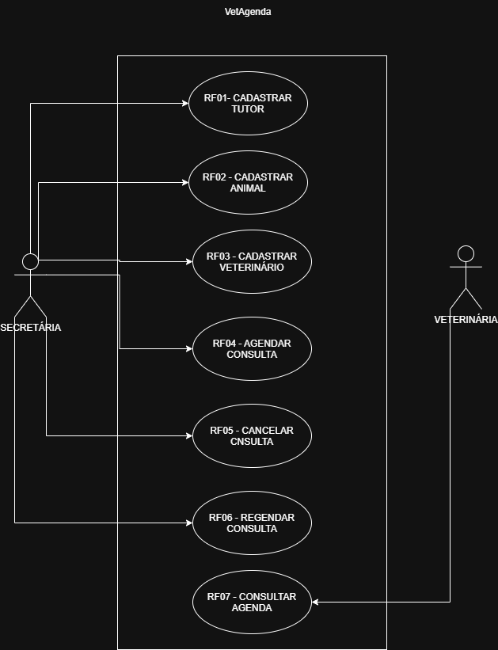

# 4.2.2 Modelagem de Casos de Uso

## 1. Atores

| Ator | Descrição |
|---|---|
| Secretária | Responsável por cadastrar tutores, animais e veterinários, organizar agendamentos, cancelar e reagendar consultas e consultar a agenda da clínica. |
| Veterinário | Responsável por consultar a agenda de atendimentos e visualizar os horários e as consultas marcadas. |

## 2. Casos de uso

Os casos de uso foram definidos a partir dos requisitos funcionais da seção 4.2.1.

| Requisito | Caso de uso |
|---|---|
| RF01 | Cadastrar tutor |
| RF02 | Cadastrar animal |
| RF03 | Cadastrar veterinário |
| RF04 | Agendar consulta |
| RF05 | Cancelar consulta |
| RF06 | Reagendar consulta |
| RF07 | Consultar agenda |

O RF08 — Impedir conflito de horário — será tratado como uma regra aplicada durante o caso de uso Agendar consulta, pois verifica se o veterinário já possui uma consulta no horário escolhido.

## 3. Diagrama de casos de uso

**Figura 1 — Diagrama de casos de uso do VetAgenda**

**Fonte:** Elaborado pela autora (2026).

O diagrama representa os atores Secretária e Veterinário e suas interações com as funcionalidades do VetAgenda. A Secretária realiza os cadastros e organiza as consultas, enquanto o Veterinário consulta a agenda de atendimentos. A verificação de conflitos de horário ocorre durante o agendamento.

## 4. Especificação do caso de uso principal

### UC04 — Agendar consulta

**Objetivo:** Registrar uma consulta na agenda da clínica veterinária.

**Ator principal:** Secretária.

**Pré-condição:** A Secretária está autorizada a utilizar o sistema e os cadastros necessários estão disponíveis.

**Pós-condição:** A consulta é registrada na agenda, desde que os dados necessários sejam válidos e não exista conflito de horário para o veterinário escolhido.

### 4.1 Fluxo principal

1. A Secretária informa o animal, o veterinário, a data e o horário desejados para a consulta.
2. O sistema verifica se os dados informados estão preenchidos e são válidos.
3. O sistema verifica se existe conflito de horário para o veterinário escolhido.
4. O sistema confirma que o horário está disponível.
5. O sistema registra a consulta na agenda.
6. O sistema informa que o agendamento foi realizado.

### 4.2 Fluxo alternativo — Dados incompletos

**Ponto de entrada:** Passo 2 do fluxo principal.

1. O sistema identifica que faltam informações necessárias para o agendamento.
2. O sistema informa quais dados precisam ser completados.
3. A Secretária complementa os dados.
4. O fluxo retorna ao passo 2 do fluxo principal.

### 4.3 Fluxo de exceção — Conflito de horário

**Ponto de entrada:** Passo 3 do fluxo principal.

1. O sistema identifica que o veterinário já possui uma consulta no horário escolhido.
2. O sistema informa que não é possível realizar o agendamento naquele horário.
3. O sistema não registra a consulta.
4. O caso de uso termina sem realizar o agendamento.

### 4.4 Decisões de projeto adotadas

Para a especificação do caso de uso, foram adotadas as seguintes decisões:

- Os dados obrigatórios para agendar uma consulta são animal, veterinário, data e horário.
- Quando houver conflito de horário, o sistema não registrará a consulta.
- A troca de veterinário será permitida durante o reagendamento de uma consulta.
- O sistema deverá impedir duas consultas para o mesmo veterinário no mesmo horário.

Essas definições são decisões de projeto para a versão acadêmica do VetAgenda e não representam respostas confirmadas pela cliente fictícia.

## 5. Rastreabilidade com a seção 4.2.1

| Requisito funcional | Caso de uso ou local correspondente |
|---|---|
| RF01 — Cadastrar tutor | Caso de uso Cadastrar tutor |
| RF02 — Cadastrar animal | Caso de uso Cadastrar animal |
| RF03 — Cadastrar veterinário | Caso de uso Cadastrar veterinário |
| RF04 — Agendar consulta | Caso de uso Agendar consulta |
| RF05 — Cancelar consulta | Caso de uso Cancelar consulta |
| RF06 — Reagendar consulta | Caso de uso Reagendar consulta |
| RF07 — Consultar agenda | Caso de uso Consultar agenda |
| RF08 — Impedir conflito de horário | Passo 3 do fluxo principal e fluxo de exceção de Agendar consulta |

**Todo requisito funcional está representado?**

Sim. Os requisitos RF01 a RF07 estão associados aos casos de uso, e o RF08 está representado como uma regra aplicada durante o agendamento.

**Toda elipse tem um requisito correspondente?**

Sim. Cada caso de uso listado corresponde a um requisito funcional da seção 4.2.1.

**Existe algum requisito que não virou elipse?**

Sim. O RF08 não possui uma elipse própria porque representa uma regra aplicada durante o agendamento, e não uma interação independente do ator com o sistema.
