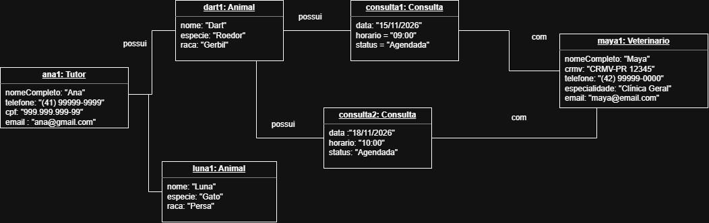

# 4.2.3 Modelagem de Classes

## 1. Dos substantivos às classes

A modelagem de classes do VetAgenda foi elaborada a partir dos requisitos funcionais, das histórias de usuário e do caso de uso principal descritos nas seções 4.2.1 e 4.2.2.

Foram identificados quatro conceitos principais para representar as informações do sistema: Tutor, Animal, Veterinário e Consulta.

| Substantivo identificado | Classe proposta | Justificativa |
|---|---|---|
| Tutor | `Tutor` | Representa a pessoa responsável pelo animal. |
| Animal | `Animal` | Representa o animal atendido pela clínica veterinária. |
| Veterinário | `Veterinario` | Representa o profissional responsável pelos atendimentos. |
| Consulta | `Consulta` | Representa o atendimento agendado, incluindo data, horário e situação. |

## 2. Classes, atributos e operações

Os atributos foram definidos com base nos dados necessários para os cadastros e agendamentos. As operações representam as ações relacionadas às responsabilidades de cada classe.

### 2.1 Classe Tutor

**Atributos:**

- `nomeCompleto`
- `telefone`
- `cpf`
- `email`

**Operações:**

- `cadastrar()`

### 2.2 Classe Animal

**Atributos:**

- `nome`
- `especie`
- `raca`

**Operações:**

- `cadastrar()`

O tutor responsável será representado pelo relacionamento entre as classes `Animal` e `Tutor`.

### 2.3 Classe Veterinario

**Atributos:**

- `nomeCompleto`
- `crmv`
- `telefone`
- `especialidade`
- `email`

**Operações:**

- `cadastrar()`
- `consultarAgenda()`

### 2.4 Classe Consulta

**Atributos:**

- `data`
- `horario`
- `status`
- `motivoCancelamento`

**Operações:**

- `agendar()`
- `cancelar()`
- `reagendar()`
- `verificarConflitoDeHorario()`

O atributo `motivoCancelamento` poderá ficar vazio quando não houver motivo registrado. A operação `verificarConflitoDeHorario()` representa a regra RF08, que impede duas consultas para o mesmo veterinário no mesmo horário.

## 3. Relacionamentos entre as classes

O VetAgenda possui três associações principais entre as classes `Tutor`, `Animal`, `Veterinario` e `Consulta`. As multiplicidades representam a quantidade mínima e máxima de objetos que podem participar de cada relacionamento.

### 3.1 Relacionamento entre Tutor e Animal

Um tutor pode ser responsável por nenhum ou vários animais cadastrados no sistema. Cada animal deve estar vinculado a exatamente um tutor responsável.

**Multiplicidades:**
- `Tutor`: `0..*` animais.
- `Animal`: `1` tutor responsável.

### 3.2 Relacionamento entre Animal e Consulta

Um animal pode não possuir consultas ou possuir várias consultas ao longo do tempo. Cada consulta deve estar associada a exatamente um animal.

**Multiplicidades:**
- `Animal`: `0..*` consultas.
- `Consulta`: `1` animal.

### 3.3 Relacionamento entre Veterinario e Consulta

Um veterinário pode não possuir consultas agendadas ou possuir várias consultas. Cada consulta deve estar associada a exatamente um veterinário responsável pelo atendimento.

**Multiplicidades:**
- `Veterinario`: `0..*` consultas.
- `Consulta`: `1` veterinário.

### 3.4 Justificativa dos relacionamentos

As associações foram definidas de acordo com as necessidades do VetAgenda. O relacionamento entre `Tutor` e `Animal` permite identificar o responsável por cada animal. Os relacionamentos entre `Animal` e `Consulta` e entre `Veterinario` e `Consulta` permitem identificar o animal atendido e o profissional responsável por cada agendamento.

Não foi utilizada composição ou agregação com losango, pois os relacionamentos descritos não exigem representar uma relação de posse com dependência de ciclo de vida entre os objetos.

## 4. Diagrama de classes

O diagrama de classes apresenta a estrutura do VetAgenda, mostrando as classes identificadas, seus atributos, suas operações e os relacionamentos entre elas, incluindo as multiplicidades. A regra de conflito de horário também está representada no diagrama.

**Figura 2 — Diagrama de classes do VetAgenda.**

Fonte: Elaborado pela autora.
## 5. Teste com objetos

Para verificar se os relacionamentos e as multiplicidades do diagrama de classes representam corretamente o funcionamento do VetAgenda, foi criada uma situação de exemplo.

Considere a seguinte situação:

- Ana é uma tutora cadastrada no sistema.
- Ana possui dois animais cadastrados: Dart e Luna.
- Maya é uma veterinária cadastrada.
- Dart possui duas consultas agendadas com Maya, em datas e horários diferentes.
- Luna ainda não possui consultas agendadas.

### 5.1 Objetos identificados

| Objeto | Classe | Informações |
|---|---|---|
| `ana1` | `Tutor` | Nome: Ana |
| `dart1` | `Animal` | Nome: Dart |
| `luna1` | `Animal` | Nome: Luna |
| `maya1` | `Veterinario` | Nome: Maya |
| `consulta1` | `Consulta` | 15/11/2026, às 09:00 |
| `consulta2` | `Consulta` | 18/11/2026, às 10:00 |

### 5.2 Diagrama de objetos

O diagrama de objetos representa uma situação concreta do VetAgenda, mostrando os objetos cadastrados e suas ligações.

**Figura 3 — Diagrama de objetos do VetAgenda.**

Fonte: Elaborado pela autora.

### 5.3 Verificação dos relacionamentos

A situação demonstra que:

- Um tutor pode estar relacionado a vários animais.
- Cada animal possui um único tutor responsável.
- Um animal pode possuir várias consultas.
- Cada consulta está relacionada a um único animal.
- Um veterinário pode estar relacionado a várias consultas.
- Cada consulta possui um único veterinário responsável.

Portanto, os relacionamentos e as multiplicidades definidos no diagrama de classes são compatíveis com a situação apresentada.

## 6. Rastreabilidade com a modelagem de casos de uso

A rastreabilidade permite verificar se as operações definidas nas classes estão relacionadas aos requisitos funcionais e às interações descritas na seção 4.2.2.

### 6.1 Relação entre operações e requisitos

| Classe | Operação | Requisito relacionado |
|---|---|---|
| `Tutor` | `cadastrar()` | RF01 – Cadastrar tutor |
| `Animal` | `cadastrar()` | RF02 – Cadastrar animal |
| `Veterinario` | `cadastrar()` | RF03 – Cadastrar veterinário |
| `Veterinario` | `consultarAgenda()` | RF07 – Consultar agenda |
| `Consulta` | `agendar()` | RF04 – Agendar consulta |
| `Consulta` | `cancelar()` | RF05 – Cancelar consulta |
| `Consulta` | `reagendar()` | RF06 – Reagendar consulta |
| `Consulta` | `verificarConflitoDeHorario()` | RF08 – Impedir conflito de horário |

### 6.2 Conferência da cobertura

As operações das classes representam as principais ações previstas nos requisitos funcionais do VetAgenda.

O cadastro de tutores, animais e veterinários é representado pelas operações `cadastrar()` de suas respectivas classes. As operações da classe `Consulta` contemplam o agendamento, o cancelamento, o reagendamento e a verificação de conflitos de horário.

A operação `consultarAgenda()` representa a consulta da agenda pelo veterinário. A secretária também pode consultar a agenda conforme previsto no RF07, sem que isso exija necessariamente a criação de uma classe específica para ela no modelo de domínio.

Dessa forma, a modelagem de classes apresenta uma correspondência com os requisitos funcionais definidos na seção 4.2.2.
