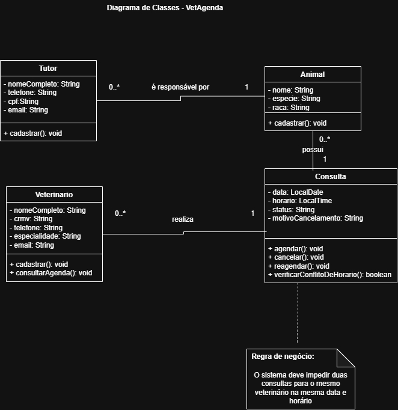

# 4.2.3 Modelagem de Classes

## 1. Dos substantivos às classes

A modelagem de classes do VetAgenda foi elaborada a partir dos requisitos funcionais, das histórias de usuário e do fluxo principal do caso de uso UC04 – Agendar consulta, descritos nas seções 4.2.1 e 4.2.2.

Durante a identificação dos substantivos, foram analisados os elementos que precisam ser armazenados pelo sistema, as informações que representam características de outros elementos e os termos que não precisam se transformar em classes.

| Substantivo identificado | Resultado | Justificativa |
|---|---|---|
| Tutor | Classe `Tutor` | Representa a pessoa responsável pelo animal e possui dados próprios que precisam ser cadastrados. |
| Animal | Classe `Animal` | Representa o animal atendido pela clínica e possui informações próprias. |
| Veterinário | Classe `Veterinario` | Representa o profissional responsável pelos atendimentos e possui dados de cadastro. |
| Consulta | Classe `Consulta` | Representa o atendimento agendado e armazena informações sobre data, horário e situação. |
| Data | Atributo de `Consulta` | É uma informação necessária para identificar quando a consulta acontecerá. |
| Horário | Atributo de `Consulta` | É uma informação necessária para definir o horário do atendimento. |
| Secretária | Ator do sistema | Representa quem realiza operações no sistema, não sendo necessário tratá-la como classe neste modelo. |
| Agenda | Não se tornou classe | Representa a organização das consultas, que pode ser consultada por meio dos relacionamentos com a classe `Consulta`. |
| Conflito de horário | Regra de negócio | Representa uma condição que o sistema deve verificar durante o agendamento, não uma entidade independente. |

A seleção das classes considerou os elementos que precisam ser representados e armazenados pelo sistema. Informações que são características de outras entidades foram definidas como atributos, enquanto atores e regras de negócio foram tratados de acordo com suas responsabilidades.

## 2. Classes, atributos e operações

Os atributos foram definidos com base nos dados necessários para os cadastros e agendamentos. As operações representam as ações relacionadas às responsabilidades de cada classe. A coluna "Veio de" indica o requisito funcional que deu origem a cada elemento.

### 2.1 Classe Tutor

**Atributos:**

| Atributo | Tipo | Veio de |
|---|---|---|
| `nomeCompleto` | `String` | RF01 – Cadastrar tutor |
| `telefone` | `String` | RF01 – Cadastrar tutor |
| `cpf` | `String` | RF01 – Cadastrar tutor |
| `email` | `String` | RF01 – Cadastrar tutor |

**Operações:**

| Operação | Veio de |
|---|---|
| `cadastrar()` | RF01 – Cadastrar tutor |

### 2.2 Classe Animal

**Atributos:**

| Atributo | Tipo | Veio de |
|---|---|---|
| `nome` | `String` | RF02 – Cadastrar animal |
| `especie` | `String` | RF02 – Cadastrar animal |
| `raca` | `String` | RF02 – Cadastrar animal |

**Operações:**

| Operação | Veio de |
|---|---|
| `cadastrar()` | RF02 – Cadastrar animal |

O tutor responsável será representado pelo relacionamento entre as classes `Animal` e `Tutor`.

### 2.3 Classe Veterinario

**Atributos:**

| Atributo | Tipo | Veio de |
|---|---|---|
| `nomeCompleto` | `String` | RF03 – Cadastrar veterinário |
| `crmv` | `String` | RF03 – Cadastrar veterinário |
| `telefone` | `String` | RF03 – Cadastrar veterinário |
| `especialidade` | `String` | RF03 – Cadastrar veterinário |
| `email` | `String` | RF03 – Cadastrar veterinário |

**Operações:**

| Operação | Veio de |
|---|---|
| `cadastrar()` | RF03 – Cadastrar veterinário |
| `consultarAgenda()` | RF07 – Consultar agenda |

### 2.4 Classe Consulta

**Atributos:**

| Atributo | Tipo | Veio de |
|---|---|---|
| `data` | `LocalDate` | RF04 – Agendar consulta |
| `horario` | `LocalTime` | RF04 – Agendar consulta |
| `status` | `String` | RF04, RF05 e RF06 – Agendar, cancelar e reagendar consulta |
| `motivoCancelamento` | `String` | RF05 – Cancelar consulta |

**Operações:**

| Operação | Veio de |
|---|---|
| `agendar()` | RF04 – Agendar consulta |
| `cancelar()` | RF05 – Cancelar consulta |
| `reagendar()` | RF06 – Reagendar consulta |
| `verificarConflitoDeHorario()` | RF08 – Impedir conflito de horário |

O atributo `motivoCancelamento` poderá ficar vazio quando não houver motivo registrado.

A operação `verificarConflitoDeHorario()` representa a regra RF08, que impede duas consultas para o mesmo veterinário na mesma data e no mesmo horário.

## 3. Relacionamentos entre as classes

O VetAgenda possui três associações principais entre as classes `Tutor`, `Animal`, `Veterinario` e `Consulta`. As multiplicidades representam a quantidade mínima e máxima de objetos que podem participar de cada relacionamento.

### 3.1 Relacionamento entre Tutor e Animal

Um tutor pode ser responsável por nenhum ou vários animais cadastrados no sistema. Cada animal deve estar vinculado a exatamente um tutor responsável.

**Multiplicidades:**
- `Tutor`: `0..*` animais.
- `Animal`: `1` tutor responsável.

### 3.2 Relacionamento entre Animal e Consulta

Um animal pode não possuir consultas ou possuir várias consultas ao longo do tempo. Cada consulta deve estar associada a exatamente um animal.

**Multiplicidades:**
- `Animal`: `0..*` consultas.
- `Consulta`: `1` animal.

### 3.3 Relacionamento entre Veterinario e Consulta

Um veterinário pode não possuir consultas agendadas ou possuir várias consultas. Cada consulta deve estar associada a exatamente um veterinário responsável pelo atendimento.

**Multiplicidades:**
- `Veterinario`: `0..*` consultas.
- `Consulta`: `1` veterinário.

### 3.4 Justificativa dos relacionamentos

As associações foram definidas de acordo com as necessidades do VetAgenda.

- **Tutor e Animal — é responsável por:** permite identificar qual tutor é responsável por cada animal cadastrado.
- **Animal e Consulta — possui:** permite relacionar cada consulta ao animal que será atendido.
- **Veterinario e Consulta — realiza:** permite identificar qual veterinário será responsável por cada consulta.

Não foi utilizada composição ou agregação com losango, pois os relacionamentos descritos não exigem representar uma relação de posse com dependência de ciclo de vida entre os objetos.

As associações podem ser interpretadas pelas seguintes frases: um Tutor é responsável por vários Animais; um Animal possui zero ou várias Consultas; e um Veterinario realiza zero ou várias Consultas. Cada Animal está vinculado a exatamente um Tutor, e cada Consulta está associada a exatamente um Animal e um Veterinario.

## 4. Diagrama de classes

O diagrama de classes apresenta a estrutura do VetAgenda, mostrando as classes identificadas, seus atributos, suas operações e os relacionamentos entre elas, incluindo as multiplicidades. A regra de conflito de horário também está representada no diagrama.

**Figura 2 — Diagrama de classes do VetAgenda.**

Fonte: Elaborado pela autora.
## 5. Teste com objetos

Para verificar se os relacionamentos e as multiplicidades do diagrama de classes representam corretamente o funcionamento do VetAgenda, foi criada uma situação de exemplo.

Considere a seguinte situação:

- Ana é uma tutora cadastrada no sistema.
- Ana possui dois animais cadastrados: Dart e Luna.
- Maya é uma veterinária cadastrada.
- Dart possui duas consultas agendadas com Maya, em datas e horários diferentes.
- Luna ainda não possui consultas agendadas.

### 5.1 Objetos identificados

| Objeto | Classe | Informações |
|---|---|---|
| `ana1` | `Tutor` | Nome: Ana |
| `dart1` | `Animal` | Nome: Dart |
| `luna1` | `Animal` | Nome: Luna |
| `maya1` | `Veterinario` | Nome: Maya |
| `consulta1` | `Consulta` | 15/11/2026, às 09:00 |
| `consulta2` | `Consulta` | 18/11/2026, às 10:00 |

### 5.2 Diagrama de objetos

O diagrama de objetos representa uma situação concreta do VetAgenda, mostrando os objetos cadastrados e suas ligações.

**Figura 3 — Diagrama de objetos do VetAgenda.**

Fonte: Elaborado pela autora.

### 5.3 Verificação dos relacionamentos

A situação demonstra que:

- Um tutor pode estar relacionado a vários animais.
- Cada animal possui um único tutor responsável.
- Um animal pode possuir várias consultas.
- Cada consulta está relacionada a um único animal.
- Um veterinário pode estar relacionado a várias consultas.
- Cada consulta possui um único veterinário responsável.
  
O teste confirmou que as multiplicidades definidas no modelo representam a situação apresentada. A relação entre Tutor e Animal permite que Ana esteja vinculada a Dart e Luna. A relação entre Animal e Consulta permite que Dart possua duas consultas e que Luna permaneça sem consultas. A relação entre Veterinario e Consulta permite que Maya esteja associada a diferentes atendimentos.

Portanto, o exemplo confirma as multiplicidades definidas no diagrama: um tutor pode ter vários animais, um animal pode ter várias consultas e um veterinário pode realizar várias consultas. Também confirma que cada animal possui um único tutor e cada consulta está vinculada a um único animal e a um único veterinário.
Portanto, os relacionamentos e as multiplicidades definidos no diagrama de classes são compatíveis com a situação apresentada.

## 6. Rastreabilidade com a modelagem de casos de uso

A rastreabilidade permite verificar se as operações definidas nas classes estão relacionadas aos requisitos funcionais e às interações descritas na seção 4.2.2.

### 6.1 Relação entre operações e requisitos

| Classe | Operação | Origem |
|---|---|---|
| `Tutor` | `cadastrar()` | RF01 – Cadastrar tutor |
| `Animal` | `cadastrar()` | RF02 – Cadastrar animal |
| `Veterinario` | `cadastrar()` | RF03 – Cadastrar veterinário |
| `Veterinario` | `consultarAgenda()` | RF07 – Consultar agenda |
| `Consulta` | `agendar()` | RF04 – Agendar consulta |
| `Consulta` | `cancelar()` | RF05 – Cancelar consulta |
| `Consulta` | `reagendar()` | RF06 – Reagendar consulta |
| `Consulta` | `verificarConflitoDeHorario()` | RF08 – Impedir conflito de horário |

### 6.2 Conferência da cobertura

As operações das classes representam as principais ações previstas nos requisitos funcionais do VetAgenda.

O cadastro de tutores, animais e veterinários é representado pelas operações `cadastrar()` de suas respectivas classes. As operações da classe `Consulta` contemplam o agendamento, o cancelamento, o reagendamento e a verificação de conflitos de horário.

A operação `consultarAgenda()` representa a consulta da agenda pelo veterinário. A secretária também pode consultar a agenda conforme previsto no RF07, sem que isso exija necessariamente a criação de uma classe específica para ela no modelo de domínio.

Dessa forma, a modelagem de classes apresenta uma correspondência com os requisitos funcionais definidos na seção 4.2.2.

### 6.3 Análise do fluxo de caso de uso

A análise do fluxo principal do UC04 — Agendar consulta — confirmou a necessidade das classes Animal, Veterinario e Consulta, pois o agendamento exige a identificação do animal atendido, do profissional responsável e das informações da consulta.

A verificação de disponibilidade do horário também foi analisada. Essa regra já estava prevista no RF08, portanto não foi necessário criar um novo requisito ou uma classe específica para representar o conflito de horário.

Dessa forma, o fluxo do caso de uso não revelou novas classes ou regras de negócio além das que já estavam contempladas na modelagem.

### 6.4 Revisão realizada após a análise dos requisitos

Após a conferência entre as seções 4.1 e 4.2.1, o objetivo do projeto foi revisado para deixar mais clara a prevenção de conflitos de horário. A descrição inicial apresentava a intenção de evitar conflitos, mas não explicava de forma tão direta o resultado esperado.

A revisão tornou o objetivo mais verificável, estabelecendo que o sistema deve impedir conflitos de horário para um mesmo veterinário e facilitar o acompanhamento dos atendimentos agendados.
