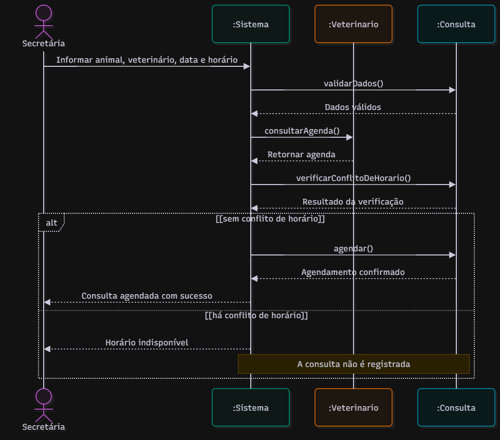

# 4.2.4 Modelagem de Sequência

<!--
Esta seção responde: no cenário principal do caso de uso, quem pede o quê a quem, em que ordem, e o que volta?

São três blocos, na ordem em que aparecem. As tabelas vêm só com o cabeçalho, como na 4.2.5.
O diagrama é do caso de uso que você especificou na 4.2.2, e os participantes são as classes da sua 4.2.3.
Um diagrama, até o teto: 4 a 6 linhas de vida, 6 a 10 mensagens e 1 fragmento alt.

Ele vai em dois arquivos com o mesmo nome: diagramas/sequencia.drawio (para editar) e diagramas/sequencia.png (para aparecer aqui).
A numeração das figuras continua de onde você parou: se a última foi a Figura 4, aqui é a Figura 5.
Na montagem final do documento as figuras são renumeradas na ordem das seções.

A mesma seção pronta, do BiblioTech, está em exemplo-bibliotech/docs/4.2.4-sequencia.md
no repositório do modelo, com o diagrama em exemplo-bibliotech/diagramas/. O BiblioTech mostra a forma. A conversa tem de ser a do seu sistema.

Quando terminar, pode apagar estes comentários.
-->

## Do fluxo às mensagens

<!-- Abra a sua especificação na 4.2.2 e as suas classes na 4.2.3. Cada passo do ator vira uma mensagem dele para o Sistema.
     Cada passo do sistema vira uma mensagem do Sistema para a classe que tem a operação, com parênteses. A resposta volta tracejada.
     Uma exceção entra no fragmento alt. Os outros desvios ficam de fora, e você diz por quê. -->

| No fluxo da 4.2.2 | Vira a mensagem | De quem para quem | Por quê |
|---|---|---|---|

## Diagrama de sequência

<!-- Desenhe no draw.io. Uma linha de vida para o ator, uma para o Sistema e uma para cada classe que participa, com dois-pontos antes do nome.
     Mensagem é seta cheia, de quem pede para quem executa. Retorno é seta tracejada, de volta para quem perguntou. O tempo corre de cima para baixo.
     O fragmento alt é um quadro com duas guardas entre colchetes e uma linha tracejada entre os andares.
     Salve diagramas/sequencia.drawio e exporte diagramas/sequencia.png. Legenda acima, fonte abaixo, e a figura descrita no texto. -->

**Figura _N_ – Diagrama de sequência de _Nome do caso de uso_**

Fonte: Autoria própria (2026).

_Descreva a figura. As linhas de vida e quem é cada uma. Depois a conversa de cima para baixo: quem pede, quem executa, o que volta. No fim, o fragmento: o que acontece em cada andar._

## Rastreabilidade com a 4.2.3

<!-- Cada mensagem com parênteses, a linha de vida em que ela chega e a operação da sua 4.2.3 que ela chama.
     Depois responda as três perguntas. Se uma mensagem não tem operação, marque com ❓ e leve a nota para a 4.2.3. -->

| Mensagem | Chega em | Operação na 4.2.3 | Passo da 4.2.2 |
|---|---|---|---|

_Toda mensagem com parênteses chega em quem tem a operação? Todo passo tem mensagem? O que o desenho mudou nas suas classes?
