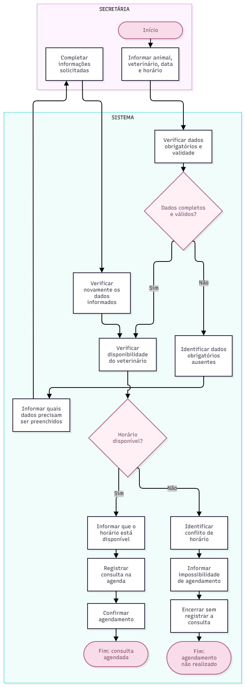

# 4.2.5 Modelagem de Atividade

# 4.2.5 Modelagem de Atividade

## Do fluxo ao diagrama

| No fluxo da 4.2.2 | Vira | Raia | Por quê? |
|---|---|---|---|
| Passo 1 | Ação: [nome da ação] | [Secretária/Sistema] | [Justificativa] |
| Passo 2 | Ação: [nome da ação] | [Secretária/Sistema] | [Justificativa] |
| Passo 3 | Ação: [nome da ação] | [Secretária/Sistema] | [Justificativa] |
| Alternativo A1 | [Ação/decisão/junção] | [Secretária/Sistema] | [Justificativa] |
| Exceção E1 | [Ação/decisão/fim] | [Secretária/Sistema] | [Justificativa] |

## Diagrama de atividades

**Figura 3 – Diagrama de atividades de [Nome do caso de uso]**

Fonte: Autoria própria (2026).

O diagrama de atividades representa o fluxo do caso de uso por meio de duas raias: Secretária e Sistema. Cada ação é posicionada na raia de quem a executa.

O fluxo começa no nó inicial e segue pelas ações até alcançar um dos nós finais. As decisões são representadas por losangos e possuem saídas identificadas como [sim] e [não].

Os fluxos alternativos representam caminhos diferentes do fluxo principal e podem retornar a ele por meio de uma junção. As exceções representam situações em que o processo é encerrado sem alcançar o resultado esperado.

## Rastreabilidade com a 4.2.2

| Elemento do diagrama | Origem na 4.2.2 | Correspondência |
|---|---|---|
| [Nome da ação] | Passo [número] | [Explicação] |
| [Nome da ação] | Passo [número] | [Explicação] |
| [Nome da decisão] | Passo [número] | [Explicação] |
| [Saída da decisão] | Alternativo A1 ou exceção E1 | [Explicação] |

### Análise de rastreabilidade

**1. Todas as ações do diagrama possuem origem na especificação da 4.2.2?**

[Responder explicando a correspondência entre as ações e os passos da especificação.]

**2. Todas as decisões possuem as saídas correspondentes aos fluxos alternativos e às exceções?**

[Explicar como as saídas das decisões representam os caminhos previstos na especificação.]

**3. O diagrama revelou alguma informação que não estava clara na especificação da 4.2.2?**

[Explicar se o desenho revelou alguma necessidade de melhorar a especificação. Caso não tenha revelado, justificar.]

**Nota para revisão da 4.2.2:** [Registrar alguma informação que precisa ser esclarecida ou ajustada. Caso não exista, escrever: Não foram identificadas necessidades de revisão.]
