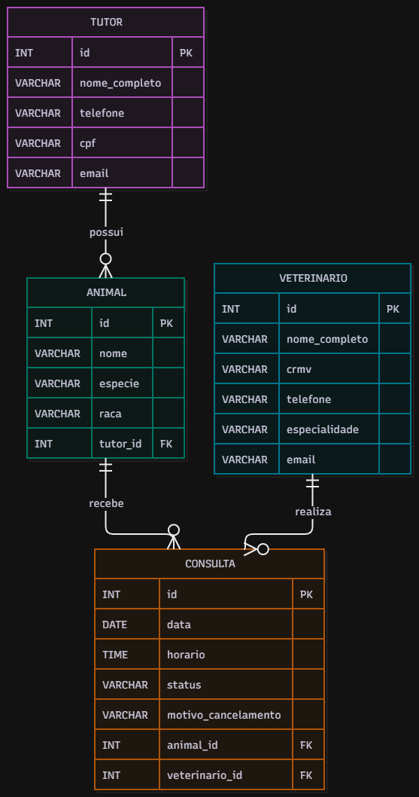

# 4.2.6 Modelagem de Banco de Dados

<!--
Esta seção responde: o que o sistema guarda, em quais tabelas, e como uma tabela se liga à outra?

São três blocos, na ordem em que aparecem. As tabelas vêm só com o cabeçalho, como na 4.2.4.
O ponto de partida é a sua 4.2.3: as classes, os atributos, as associações e o teste de objetos.
Um diagrama, até o teto: 3 a 6 tabelas, cada uma com a chave primária, e uma chave estrangeira por associação.

Ele vai em dois arquivos com o mesmo nome: diagramas/banco-de-dados.drawio (para editar) e diagramas/banco-de-dados.png (para aparecer aqui).
A numeração das figuras continua de onde você parou: se a última foi a Figura 5, aqui é a Figura 6.

A mesma seção pronta, do BiblioTech, está em exemplo-bibliotech/docs/4.2.6-banco-de-dados.md
no repositório do modelo, com o diagrama em exemplo-bibliotech/diagramas/. O BiblioTech mostra a forma. As tabelas têm de ser as do seu sistema.

Quando terminar, pode apagar estes comentários.
-->

## Das classes às tabelas

<!-- Abra a sua 4.2.3. Cada classe vira uma tabela, e cada atributo vira uma coluna. Toda tabela ganha a coluna id, a chave primária.
     Cada associação vira uma chave estrangeira na tabela do lado do muitos, com o nome terminando em _id.
     Herança e muitos para muitos não existem no banco: escreva o que você decidiu. Operação não vira nada. -->

| Na 4.2.3 | Vira | Em qual tabela | Por quê |
|---|---|---|---|

## Diagrama do banco de dados

<!-- Desenhe no draw.io. Uma caixa por tabela, com o nome no alto e uma linha por coluna: a marca PK ou FK, o nome e o tipo.
     Uma linha ligando as tabelas para cada chave estrangeira. Dois tracinhos no lado do um, pé de galinha no lado do muitos.
     Nomes em minúsculas, sem acento e com sublinhado.
     Salve diagramas/banco-de-dados.drawio e exporte diagramas/banco-de-dados.png. Legenda acima, fonte abaixo, e a figura descrita no texto. -->

**Figura _N_ – Diagrama do banco de dados de _Nome do sistema_**

Fonte: Autoria própria (2026).

_Descreva a figura. As tabelas e o que cada uma guarda. Depois cada linha entre elas, lida nos dois sentidos. No fim, as decisões: o que juntou, o que criou, o que ficou de fora._

## Rastreabilidade com a 4.2.3

<!-- Primeiro a tabela: cada classe e cada associação da sua 4.2.3, e onde ela foi parar no banco.
     Depois o teste com as linhas: pegue os objetos do teste da sua 4.2.3 e escreva cada um como uma linha da tabela dele.
     Cada ligação entre dois objetos vira um número numa coluna que termina em _id.
     No fim, responda as quatro perguntas. Se a tradução criou uma coluna ou revelou uma regra, diga qual. -->

| Na 4.2.3 | No banco | Confere |
|---|---|---|

_Escreva aqui as linhas de teste, uma tabela pequena para cada tabela do banco._

_Toda classe tem tabela, ou a decisão escrita? Todo atributo tem coluna? Toda associação tem chave estrangeira
